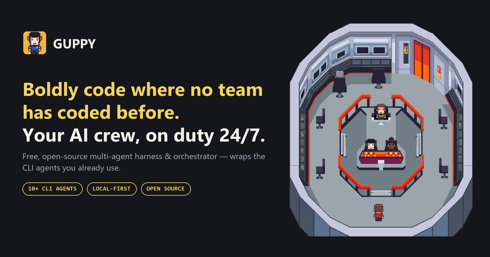
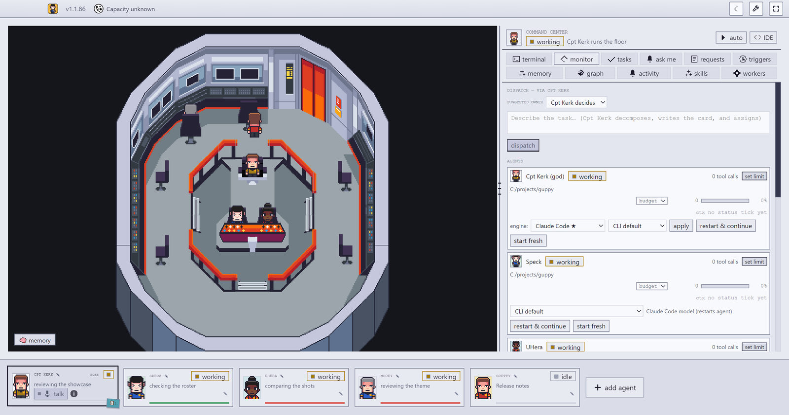
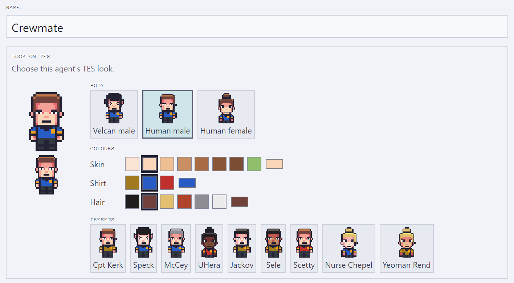
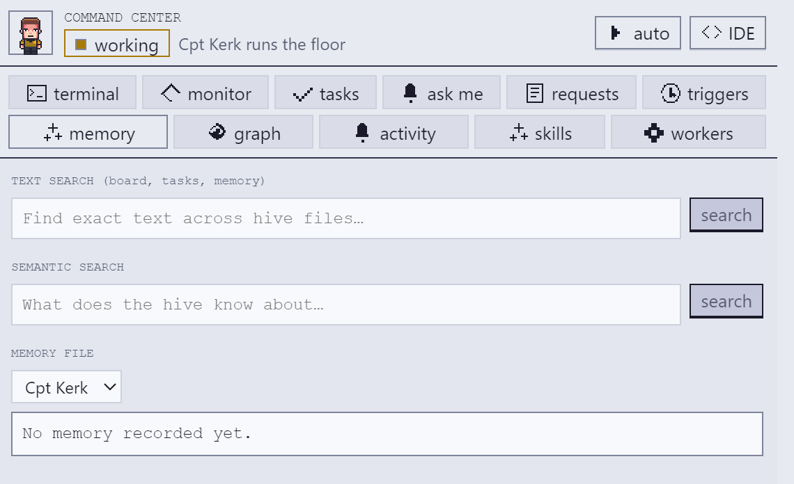

<div align="center">


# Guppy

### Agent harness to run an AI crew on your own machine — the hardened fork

**Free, open source (MIT) and performant**: a multi-agent harness that runs an AI crew of
Claude Code, Codex, Antigravity, Grok and other terminal CLI agents on your own machine, using
the subscriptions you already pay for, on their hourly limits. It turns the terminal coding
CLIs you already run into a crew that keeps working while you're away, coordinated by a
captain on your own machine.

**Actively maintained.** Latest release: **v1.1.105 (2026-11-13)**, with a Windows x64
installer; macOS and Linux build from source.<br>
[Download](https://github.com/Prozzta/guppyos/releases/latest) ·
[Website](https://guppyos.com) · [Changelog](./CHANGELOG.md)

Guppy is the hardened, independently versioned fork of
[Munder Difflin](https://github.com/HarnessMD/munder-difflin) (HarnessMD/munder-difflin),
built for running a floor continuously and unattended. It was renamed from Munder Difflin in
1.1.82; an installed copy updates in place and keeps its agents, history and settings. The
product concept, the office floor, and the foundation are upstream's work.

<p>
  <em>Electron · React · TypeScript · Pixi.js · xterm.js · node-pty</em>
</p>

<p>
  <a href="./LICENSE"></a>
  
  <a href="https://github.com/HarnessMD/munder-difflin"></a>
</p>

<br>



</div>

---

> [!NOTE]
> **Boldly code where no team has coded before. Your AI crew, on duty 24/7.**
> Guppy takes the terminal-agent CLIs you already run — `claude`, `agy`, `codex`,
> `grok`, and friends — and turns them into a self-coordinating crew: each agent gets
> long-term memory, a mailbox, and a station on a 2D floor. The captain (**Cpt Kerk**,
> the god agent) routes the work between them while you watch; you command the captain.

## Contents

- [What it is](#what-it-is)
- [How it works](#how-it-works)
- [Getting started](#getting-started)
- [Why this fork exists](#why-this-fork-exists)
- [How this fork is developed](#how-this-fork-is-developed)
- [Architecture](#architecture)
- [Design system](#design-system)
- [Telemetry](#telemetry)
- [License](#license)
- [Acknowledgements](#acknowledgements)

## What it is

Guppy is a desktop app that wraps **real terminal-agent CLIs** as fully-capable
agents, wires them into a **hive**, and puts **a captain** in charge — the god agent
(Cpt Kerk on the TES bridge, Michael in the office theme), the one agent *you* talk to
in order to get things done.

- **Every terminal is an agent.** Each `claude`, `agy`, `codex`, `grok`, or custom
  session runs as a real process in a pseudo-terminal (`node-pty`), byte-for-byte
  authentic, rendered with xterm.js.
- **Every agent is an avatar.** Sessions appear as crew on a Pixi.js floor (the TES
  bridge, or the office theme) — they walk to their stations as they work, and envelopes
  fly station-to-station when they message each other.
- **The hive coordinates them.** Agents read their memory and get their mail from the app; the
  router moves messages between inboxes; the GOD agent adjudicates, assigns, and escalates only
  when it needs you.
- **Memory that persists.** A markdown-first memory layer with semantic recall and
  automatic condensation, so agents remember across sessions without their memory files
  growing forever.

<p align="center">
  
</p>
<p align="center">
  
  
</p>

## How it works

```
            you ── talk to ──►  ┌─────────────┐
                                │  GOD agent  │  orchestrator / supervisor
                                │ (captain's  │  roster · routing · adjudication
                                │   chair)    │  blackboard · task ledger
                                └──────┬──────┘
                                       │ assigns · routes · escalates
              ┌────────────────────────┼────────────────────────┐
              ▼                         ▼                         ▼
        ┌───────────┐            ┌───────────┐            ┌───────────┐
        │  agent A  │  message   │  agent B  │  message   │  agent C  │
        │ provider  │ ─────────► │ provider  │ ─────────► │ provider  │
        │  + memory │            │  + memory │            │  + memory │
        └───────────┘            └───────────┘            └───────────┘
              └──────── shared hive: memory · mailbox · blackboard · log ───────┘
```

1. **You spawn agents** — each is a normal terminal process with its own working
   directory, identity, and provider-specific lifecycle.
2. **Agents collaborate through the hive** — a local folder of plain files. They write
   to their own `outbox/`; the harness's router delivers into recipients' `inbox/`. The
   hive is not a git repository: the harness runs no git there (since 1.1.53), and an
   existing `hive/.git` from an older version is left untouched.
3. **The GOD agent runs the floor** — it reads every request, resolves routine ones
   itself, and only escalates *critical* items (spend, destructive ops, scope changes)
   into an approvals queue you act on.
4. **Everything is visible** — avatars, envelopes, the live terminal stream; you can type
   back into any session, browse its files, and read its git history.

See [`HIVE.md`](./HIVE.md) for the full multi-agent design, [`SPEC.md`](./SPEC.md) for
the terminal/event plane, and [`DESIGN.md`](./DESIGN.md) for the visual system.

### Memory and claims in 1.1.103

New floors start with the claims ledger enabled. Use `memory get <key|card-id>` for a current
recorded value; use `memory search --exact` for exact text and `--newest` for newer matches first.
These tools surface recorded claims and history, not an accuracy guarantee. See the
[1.1.103 CHANGELOG entry](CHANGELOG.md#11103--2026-10-30) for behavior and limits.

## Getting started

### Prerequisites

- **Windows x64** for this fork's installer releases. Builds on macOS require **macOS 13
  (Ventura) or newer**; the codebase also builds on Linux (upstream ships all three).
- **Node.js 24** (`.nvmrc`, matching CI) and npm, plus a C/C++ toolchain for `node-pty`'s native addon.
- At least one supported agent CLI on your `PATH` — [Claude Code](https://claude.com/claude-code)
  (`claude`, the default), Antigravity (`agy`), OpenAI Codex (`codex`), or xAI Grok (`grok`).

### Install & run from source

```bash
git clone https://github.com/Prozzta/guppyos.git
cd guppyos
npm install        # postinstall rebuilds node-pty against Electron's ABI
npm run dev        # launches the Electron app with hot reload
```

On first launch you'll go through the onboarding wizard, then land on the floor. Use
**Add agent** to spawn your first session — the GOD agent takes the captain's chair
automatically (Michael's office, in the office theme).

### Other scripts

```bash
npm run build      # production build via electron-vite
npm run typecheck  # type-check the node (main/preload) and web (renderer) projects
node --test --test-concurrency=4 test/*.test.cjs   # the test suite
```

> If `node-pty` fails to load after an Electron upgrade, re-run `npm install` (the
> `postinstall` hook runs `electron-rebuild` against the current Electron ABI). Note the
> packaged installer ships natives rebuilt against Electron's ABI — an `npm ci
> --ignore-scripts` build will not.

## Why this fork exists

**The short version:** this fork takes upstream's stable **v0.4.5** release (commit
`1f6958b0`) and hardens it into **a floor you can leave running** — real work, real
provider limits, days at a time, without a human babysitting it — then rebalances what
that running floor costs. Two numbers carry the story, both measured and recorded in
the fork's ledger and release runbooks:

- **Memory condensation: from a tracked upstream issue to zero loss, proven on the
  installer.** Upstream's condensation issue is tracked as aborting "~80% of the time"
  (upstream #459). This fork rebuilt it, and the packaged release gate — the actual
  installer artifact, real model calls — condensed a real ~1 MB agent memory
  **959,571 → 91,364 bytes (~90% smaller) in 3 passes with 0 of 3,781 lines lost**;
  the same full 48-check gate passed again on the 1.1.48 build before it shipped.
- **The no-change standup: from ~214k tokens to zero.** The stock scheduled standup
  was measured at **213,949 token units per no-change run — 855,796 per day** at the
  then-live six-hour cadence. A deterministic, locally computed floor-state
  fingerprint now skips the model entirely when no material floor input has changed.

Upstream Munder Difflin is a broad, fast-moving stable base — many engines, many
integrations. This fork points the same product at that narrower, harder goal of
unattended endurance. Three ideas drive it:

- **Favour what your subscriptions have left.** Running on a metered API key — and
  monitoring the floor by token usage — still works; this fork simply rebalances the
  default to favour the *remaining allowance* of the subscriptions you already pay
  for (Claude, Codex, Antigravity), on the plans that allow it. A capacity seam
  through the whole app tracks each provider pool's remaining allowance and admits or
  holds automatic work by it, under one fail-closed rule: never type an automatic
  message into a live terminal, and never when the provider allowance is limited or
  unknown. The app's own background model use — memory condensation via headless
  `claude --print` — runs on the subscription login, with the API-key environment
  variables stripped from that child process so background work can never silently
  switch to pay-as-you-go metering.
- **Spend fewer tokens.** The floor's biggest measured waste was spending model turns to
  discover nothing had changed: the stock hourly standup cost ~214k tokens per no-change
  run at the measured baseline. It was replaced with a deterministic, locally computed
  floor-state fingerprint — if no material input changed, no model is invoked at all.
  The idle heartbeat ships off by default with a measured per-setting cost table, and
  automatic memory condensation keeps each agent's memory bounded instead of growing
  (and costing) forever.
- **Local-only.** The whole floor lives on your machine: agents are local terminal
  processes, and the hive — memory, mailboxes, board, log — is a local folder of
  plain files, not a hosted service. This fork's builds are compiled without the
  upstream analytics key, which makes the analytics module a verified no-op — no
  client, no install id, nothing sent (see [Telemetry](#telemetry)) — because a floor
  that runs your work locally should observe itself locally too. And the auto-updater
  is pinned to this repository, strictly notify-only — nothing downloads or installs
  without you.

One discipline makes those three trustworthy: **correctness over coverage, proven per
release.** A multi-agent floor fails in ways that only surface when it runs
unattended — a lost lifecycle event
leaves an agent "busy" forever; a wake typed into a live turn corrupts it; a
memory-condense pass that trusts the model loses history. This fork treats each of those
as a release blocker, and every change is independently audited before it ships: code
review against a written design, adversarial replay probes, hand-mutant runs that prove
each guarantee is pinned by a test that actually fails without it, and packaged canaries
that exercise the real installer artifact. The line is versioned independently (the
1.1.x series) with its own Windows x64 installer cuts.

Upstream deserves full credit for the concept and the foundation; this fork exists
because we run the thing in anger and needed it to survive that.

## How this fork is developed

The floor develops itself. This fork is built by a multi-agent Guppy floor —
an orchestrator dispatching work to builder agents, with a dedicated auditor agent
independently verifying every change (replay probes, hand mutants, packaged canaries,
installer verification) before it is accepted. The audit records live alongside the
work, and a change that fails audit goes back with a written finding and a required fix.
It is slower than merging your own PRs, and it is why the guarantees above are stated
as facts rather than hopes.

The release-by-release story of the fork (1.1.45 to 1.1.105) is in the
[CHANGELOG](./CHANGELOG.md#fork-milestones-1145--11105).

## Architecture

Two data planes feed one renderer:

- **Terminal plane.** The main process owns a `PtyManager` that spawns each agent as a
  `node-pty` process and streams output over per-id IPC. The renderer talks only through
  a typed `window.cth` bridge ([`src/preload/index.ts`](./src/preload/index.ts)), which
  also exposes sandboxed filesystem and git helpers.
- **Hive / event plane.** `hive.ts` is the on-disk multi-agent layer; `hooks.ts` runs the
  hook server that provider bridges deliver lifecycle payloads to. `reflect.ts` owns memory
  condensation. The router delivers messages, drains provider outboxes, the GOD agent
  adjudicates, and idle/inbox wakeups deliver workers' mail — with the wake
  coordinator as the single authority on when an agent may be prompted.
- **Hook transports.** Each provider reaches the hook server the cheapest way it supports:
  - **Claude** posts to a loopback HTTP route (`/hook/<id>/<token>`), authenticated by a
    per-spawn token in the URL. Its status line is a small script Claude's own shell reads
    in (`hive/bin/claude-status.sh`), posting to `/status/<id>/<token>` with shell
    built-ins only: no process per refresh.
  - **Codex** tool hooks are `mcp_tool` hooks into an in-app MCP endpoint (`/mcp/…`); the
    payload is rebuilt from Codex's rollout and named as Codex's own command hooks name it.
  - **Antigravity** observational hooks and its status line go one-way through a small
    `agy-oneway.cmd` (cmd built-ins, no Node start), written in AGY's documented hooks
    schema.
  - Hooks that must answer (a deny, a block, a steer) keep the command shim, and every agent
    falls back to it when the broker is down. A per-minute `hook-transport` row in
    `log.jsonl` shows which route each agent's hooks took.
- **The event log.** `log.jsonl` and `cost-ledger.jsonl` are appended through a descriptor
  that stays open (an antivirus rescans a file on every open and close) and roll over at
  8 MB to `log.<stamp>.jsonl` (the last 8 kept; the ledger keeps all). A file that was
  already oversize is kept whole as `*.legacy-*.jsonl`. The activity feed and the lifetime
  cost read across the rolled-over files; search them as `log*.jsonl`.
- **Semantic memory: the built-in memory engine** (the only memory since 1.1.59; no Python
  is used or needed). Agents run `memory search` / `wake-up` / `status`, served by the
  engine.
  - **Switch.** Settings' semantic memory (on by default) is the one switch. There is no
    mode file: one left from an earlier version (`hive/memory-engine.json`) is removed at start.
  - **Worker.** One lazy `utilityProcess` worker, started 30 s after the first window loads
    (or on the first memory request), at below-normal priority. The model is unloaded when
    idle.
  - **Index.** One SQLite file (`better-sqlite3`, WAL) with FTS5 plus `sqlite-vec` (`vec0`,
    cosine). A hybrid search fuses the two by RRF.
  - **Embeddings.** A single bundled all-MiniLM-L6-v2 (fp32) runs on `onnxruntime-node`, CPU
    only. It uses its own WordPiece tokenizer, is pinned by SHA-256 and is never downloaded.
  - **Sources.** An allow-list: each agent's `memory.md` and its direct `agents/<id>/*.md`
    notes, plus opt-ins in `hive/memory-sources.json`. `board.md` and path escapes are
    rejected. Indexing is automatic; there is no `mine` step.
  - **Indexing and compaction.** Chunk-diff ingestion, so an append re-embeds only new
    chunks. Compaction runs through `VACUUM INTO` and a verified swap.
  - **Storage.** The index lives in the app's data folder
    (`<userData>/memory/<hash>.sqlite`). It is disposable and rebuilt from the Markdown. A
    reset deletes it (after the worker has stopped); a home move leaves the new home to
    build its own.
  - **Access.** Agents reach it through the `memory` command (`hive/bin/memory`, first on
    the agent's one PATH) that posts to `/memory/<token>` on the loopback broker,
    authenticated by a per-spawn `MEMORY_TOKEN`. When the command cannot be put on PATH, the
    agent gets no memory line in its prompt. The Memory panel, Command Center and voice tools
    ask the engine directly, inside the app.
  - **Measured against the old Python CLI,** on frozen copies of a real hive:
    - **Quality**, over 373 real, labelled searches: NDCG@5 +20.7 points and recall@10 +32.5
      points overall, and better in every search type.
    - **Speed**, end to end through the agent's own command: about 120–165 ms against about
      1.5–1.8 s.
    - **Storage:** an index of 10.6 MB against an 80 MB palace.
  - **Data from the retired Python CLI** (`<home>/palace`) is never read. The app does not
    delete it: removing it, and the CLI itself, is a one-time manual clean-up.
  - **An early `wake-up`** (since 1.1.55) does not meet an empty index: each agent's own
    notes are indexed first, and a wake-up waits up to 5 s for them.
- **Mail in context** (since 1.1.75; mid-turn since 1.1.55). The hook server tracks each
  agent's turn and puts each new message's text into the agent's context as a `<hive-mail>`
  block, at the start of its next turn or, while it works, at its next tool call; the app files
  handled mail into `inbox/.done` itself. Providers that still read their own files (gemini,
  grok, opencode, pi, cursor) get the 1.1.55 `<inbox-update>` notice instead (each announced
  once, at most five listed, sender text escaped). An agent whose mail stops reaching it through
  its hooks (3 wakes) is switched to that notice too, with an alert; with no hook traffic at all,
  it moves its own files. A message may carry `supersedes`, and the
  router marks the older one `superseded_by`.
- **The heavy-job lock** (since 1.1.55). A `PreToolUse` classifier recognises installs,
  builds, packaging, full suites and benches (through `bash -c`, `cmd /c` and PowerShell
  wrappers) and takes one of N slots (Settings → **Heavy jobs at once**, read live). Over the
  limit, the call is denied with the holder's name. A slot is freed by the call's
  `PostToolUse` / `PostToolUseFailure`, by a watcher that runs only while a slot is held
  (one hidden process listing every 20 s: the job counts as running while the agent's
  terminal has a process started after the slot was taken; a failed listing never frees a
  slot), by the terminal's exit, or after 60 minutes. A node script is judged by what it
  spawns, one hop deep: `node e.js` whose e.js runs `execSync('npm test')` is the suite, but a
  command spawned by a script that e.js spawns is not followed.
- **Talk** (1.1.55 only; **removed in 1.1.56**, to return as a separate build). The main app
  runs no Talk code. The private history 1.1.55 wrote under the app's data folder
  (`threads`) is left on disk untouched.

The renderer is presentation: main remains the sole submission authority, and nothing
the UI displays can cause or prevent a wake.

## Design system

The aesthetic is **Animal Crossing × Earthbound × SNES menu UI** — pixel-snapped, chunky,
friendly. [`DESIGN.md`](./DESIGN.md) is canonical; every component derives from its
tokens. The Guppy brand layers the **maroon** (`#6E1423`) carried over from the office
theme and **gold** (`#F4D35E`) on top for logo and chrome.

## Telemetry

Per upstream's [`TELEMETRY.md`](./TELEMETRY.md), the analytics module gates every send
on a build-time key ([`src/main/analytics.ts`](./src/main/analytics.ts)); compiled
without it, the module constructs no client, writes no install id, and sends nothing.
This fork's builds are compiled without that key — verified on the shipped installer,
whose bundle is byte-identical to a keyless rebuild.

## License

> [!IMPORTANT]
> **Asset licensing.** The bundled pixel art (tilesets and maps) is **Modern Interiors -
> RPG Tileset [16X16]** by [LimeZu](https://limezu.itch.io/moderninteriors), used under
> the **Complete Version licence**, which permits editing and use in commercial and
> non-commercial projects. **Credit to LimeZu is required by that licence** and must stay
> in place. The Office cast is not LimeZu art; it is drawn procedurally in
> `portraitArt.ts`. See
> [`src/renderer/src/assets/ATTRIBUTION.md`](./src/renderer/src/assets/ATTRIBUTION.md).

The **source code** is licensed under the **MIT License** — see [`LICENSE`](./LICENSE).
The MIT grant covers the code only; the bundled pixel art is licensed separately from
LimeZu and is carved out in [`NOTICE.md`](./NOTICE.md), as is the TES theme artwork (below).
*Munder Difflin* is an affectionate
parody and is not affiliated with NBC's *The Office* or Dunder Mifflin.

### Artwork licence

> [!IMPORTANT]
> **TES artwork.** The TES theme art (the pack art and bridge map in
> [`themes/tes`](./themes/tes), the Speck icon set in `build/icon.*` and
> `src/renderer/src/assets/brand/logo.png`, and the TES art shown in the
> [`.github/media`](./.github/media) images) is **© 2026 Prozzta**, licensed under
> [`themes/tes/LICENSE-ARTWORK.md`](./themes/tes/LICENSE-ARTWORK.md), which permits editing
> and use in commercial and non-commercial projects, and shipping it inside a project that
> uses it, but not reselling or redistributing the art itself. **Credit is required:**
> "Artwork by Prozzta", with a link to
> [github.com/Prozzta/guppyos](https://github.com/Prozzta/guppyos). The code, and the app UI
> around the art in those images, stay under the MIT License; the LimeZu tilesets and the
> Office cast keep their own terms (above; the Office cast is MIT code).

## Acknowledgements

- **[HarnessMD/munder-difflin](https://github.com/HarnessMD/munder-difflin)** —
  the upstream project this fork is built on: the concept, the office floor, the hive
  design, and the foundation of everything above.
- [LimeZu](https://limezu.itch.io/) for the *Modern Interiors* pixel-art tilesets
  (Complete Version licence).
- [`shahar061/the-office`](https://github.com/shahar061/the-office) for the office
  tileset/map vendoring.
- [Pixi.js](https://pixijs.com/) · [xterm.js](https://xtermjs.org/) ·
  [node-pty](https://github.com/microsoft/node-pty) ·
  [electron-vite](https://electron-vite.org/) · [CodeMirror](https://codemirror.net/)
  for the libraries this is built on.
- *The Office* (US) for Munder Difflin, Inc.
